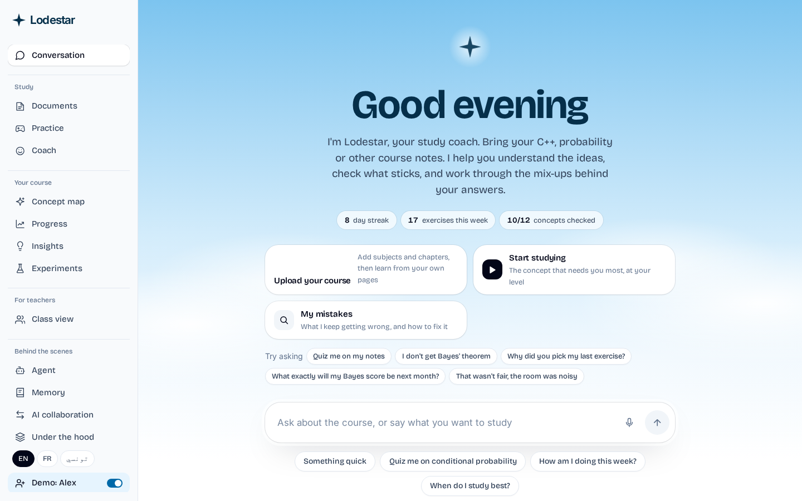
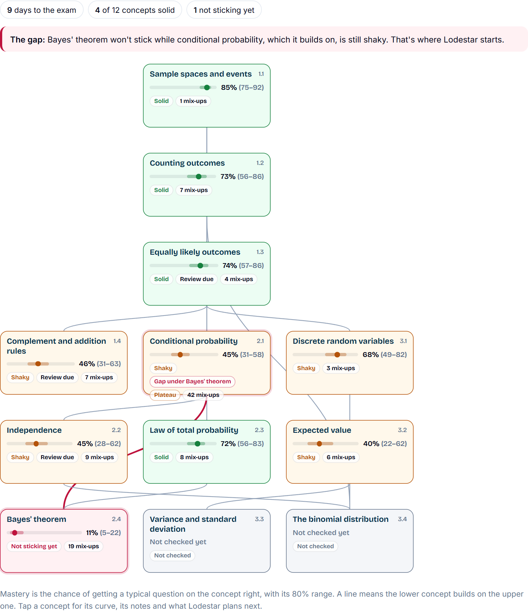
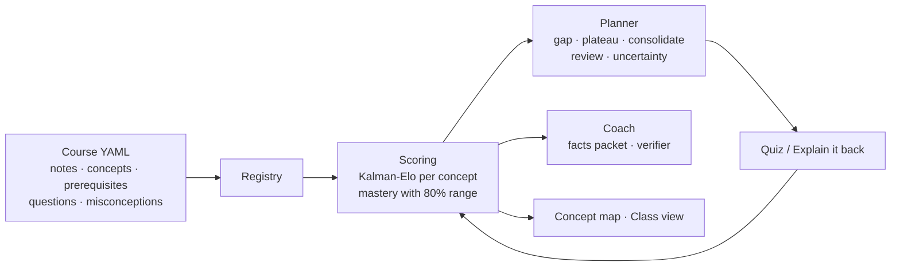

# Lodestar: a study coach that finds why a concept won't stick

**Live at [lodestar-2bej.onrender.com](https://lodestar-2bej.onrender.com/)**. Press "Demo person"
to look around as Alex (free tier: the first load can take up to a minute).

### Stack

| Layer | What it runs on |
|---|---|
| **Frontend** | React 19 · TypeScript 6 · Vite 8 · Tailwind CSS 4 · jsPsych 8 · ECharts 6 · KaTeX |
| **Backend** | Python 3.14 · FastAPI · Pydantic v2 · SQLAlchemy 2 + Alembic |
| **Agent** | LangGraph 1.2 (Postgres checkpoints) · LangChain providers (Gemini, Claude, OpenAI, Ollama…) · MCP server + CLI |
| **Data** | PostgreSQL 18 on Neon (event log, profiles, `jsonb`) · Qdrant Cloud (memory and notes search) · fastembed / Gemini embeddings |
| **Models** | Kalman-Elo mastery with 80% ranges · LightGBM engagement model (OULAD) · conformal growth forecast |
| **Languages** | English · French · Tunisian Arabic (Derja, right to left) |
| **Deploy** | Docker · Render (one web service) · GitHub Actions CI |

Lodestar is an AI study coach for a university course. It finds **which** concepts aren't sticking
and **why**: often the gap is in a concept they build on. It explains them **from the student's own
course notes**, quizzes at the right level, names the **misconception** behind a wrong answer, asks
the student to explain the idea back, and brings concepts back **before they fade**. Teachers see
where the whole class is, as counts.

Every estimate comes with a range, every number the coach says is cited, and every choice comes with
its reason. Lodestar measures what a student knows about the course and nothing else: it never
labels anyone.





## The problem it answers

> How can an AI solution respond to students' difficulties in understanding their courses, enrich
> how they learn, and lastingly improve their educational experience?

| What gets in the way | What Lodestar does |
|---|---|
| A student fails Bayes' theorem again and again, and more Bayes exercises don't help | The **gap rule** walks down the prerequisite map to the deepest shaky concept (here, conditional probability) and starts there, saying why |
| Wrong answers only say "wrong" | Every wrong option is tagged with the **misconception** it shows (swapping P(A\|B) and P(B\|A), the gambler's fallacy…); the feedback names it and gives the fix |
| Being sure and wrong goes unnoticed | **"How sure?"** on every answer: confident errors are flagged as mix-ups, and they're the easiest to fix once seen |
| Re-reading feels like learning | **Explain it back** in your own words; Lodestar shows which key ideas you covered |
| Chatbots make things up | Explanations come **from the course notes**, cited; a verifier rejects any number not in a fact |
| Cramming the night before | **Spaced review**: concepts come back after 1 to 10 days depending on how well they're known |
| Quitting quietly | An **engagement model** trained on 25,273 real students notices drift and offers short, easy sessions |
| Teachers find out at the exam | A **class view**: which concepts the class finds hard and the mix-ups behind them, as counts, no names |

## Try it

You need Docker (with Compose), `make`, and [uv](https://docs.astral.sh/uv/). Node 24 only for
frontend development.

```bash
make up      # creates .env with a fresh encryption key, builds and starts everything
make seed    # Alex, five weeks into Probability 1, and 24 classmates; or press "Demo person"
```

Open the link it prints (http://localhost:5173/?signin=…). Then try:

- **Start studying**: Lodestar goes to conditional probability first, because Bayes' theorem builds
  on it, and switches to explain it back because quizzes alone haven't moved it in 11 days.
- **"I don't get Bayes' theorem"**: the notes on it, where you stand, your usual mix-up, and what
  it builds on.
- **"What do I keep getting wrong?"**: the misconceptions behind your wrong answers, with fixes.
- **Concept map** and **Class view** in the sidebar.

No AI key is needed: Lodestar uses a local [Ollama](https://ollama.com) model if one is running
(`make up-ollama`) and fixed templates otherwise. A hosted model can be added in **Settings → AI
provider** with your own key (stored encrypted, shown as its last 4 characters). The terminal client
works too: `bin/lodestar login --code <token>`, then `bin/lodestar chat`.

## Your own course, or the demo's

A student who signs up studies **their own material**: they create a subject, upload a chapter
(PDF or text), check the extracted text against the original pages and validate it. From then on
"Start studying" and "Quiz me on my notes" build questions from their pages, each citing its page,
and questions are answered from their documents with the page. Before anything is validated,
Lodestar says where to add or check a chapter; it never falls back to a course they didn't upload.
This works in English, French and Derja: a French chapter gets questions in French, and a Derja
speaker asking "ma fhemtech el pile" gets the passage on stacks.

The built-in **Probability 1** course is the demo's: the demo person (Alex) and the classmates
seeded with them study it, which is what shows the concept map, the gap rule, misconception
feedback and the class view without uploading anything. `LODESTAR_BUILT_IN_COURSE=all` gives every
account the built-in course (`backend/course_scope.py`). Demo chapters to upload are in
`docs/demo/`, including a French one (`structures-de-donnees-piles-files.pdf`).

## How it decides

**Documents** lets students create subjects, upload PDF/text chapters and study one selected
chapter with page citations. Scanned PDFs require a Gemini key and Cloud AI consent; OCR uses
Gemini 3.5 Flash Lite. Review the original beside the extracted text and rendered formulas before
approving a scan for study. See [the library review notes](docs/plan/20-student-library.md) for
known transcription limitations.

For the mounted development app, run
`docker compose -p lodestar-upside -f docker-compose.yml -f docker-compose.dev.yml up -d --no-build`.



1. **Mastery** per concept: the chance of getting a typical question right, with its 80% range
   (Kalman-Elo; the range narrows with answers and widens with time away).
2. **Gap**: a concept under 45% (and fairly surely so) sends Lodestar down its prerequisites to the
   deepest shaky one.
3. **Plateau**: no trend over 10 days and 40 answers changes the format to explain it back, with a
   different way to study.
4. **Consolidate** after a strong quiz; **review** when a concept is due.
5. Otherwise the concept Lodestar knows least about, weighed with goals (exam dates), fatigue and
   repetition. Every part is shown in "Why?".

Design: [docs/plan/19-study-coach.md](docs/plan/19-study-coach.md). Everything else (agent, memory,
coach, ethics) is in [docs/plan](docs/plan/README.md) and [docs/TECHNICAL.md](docs/TECHNICAL.md).

## The course

The demo course is **Probability 1** ([registry/courses/probability.yaml](registry/courses/probability.yaml)):
16 concepts in four chapters (counting and events, conditional probability, random variables,
continuous distributions), 16 sections of notes, 91 questions, 141 wrong options tagged with 52
misconceptions, each with a fix. A course is data, not code: the loader turns each concept into a
tracked skill with a quiz and an explain-it-back, and validates that every question has exactly one
right answer, every tag exists and the prerequisites have no cycles.

## Evaluation

**Simulated students** with known true levels per concept, playing 5-question quizzes, four a
session, through the real scorer (`make sim N=200`):

| Check | Result | Target |
|---|---|---|
| Recovery of the true level after 10 sessions (correlation, mean over 16 concepts) | 0.83 (0.69 after 3) | > 0.80 |
| 80% ranges containing the true level | 84.7% | 75–85% |
| Success rate in Balanced mode | 77.8% | 80 ± 5% |
| Uncertainty after placement, worst core concept | σ 0.86 | < 0.9 |
| Clicking through quizzes and impossible answers caught (precision / recall) | 1.00 / 1.00 | > 0.9 / > 0.8 |

**Does the gap rule find the gap?** (`python -m simulator.gap_eval --users 200`) Each simulated
student gets one weak concept; everything built on it is held near it, and what it builds on is
solid. After 10 sessions:

| | Found the planted gap |
|---|---|
| Lodestar's gap rule | **64%** (128/200) |
| "Practise your weakest concept" | 26% (53/200) |
| Gap named for students with nothing planted | 6% (12/200) |

**Real data:** the engagement model was trained on one set of real students and tested on others it
never saw (OULAD, 25,273 students: AUC 0.857). The growth-forecast model was trained on 36,297
real learners' practice curves (ranges held 79.7% on held-out players); on course mastery its
coverage hasn't been measured yet.

**Not done yet:** a pilot with a real class, courses drafted from uploaded PDFs, and a review of
the French and Derja text by native-speaking students and a teacher.

## English, French and Tunisian Arabic

Lodestar speaks the languages Tunisian students study in. Pick one in the sidebar or in Settings,
or open a link with `?lang=fr` or `?lang=tn`.

- **French**: the interface, the whole course (notes, 91 questions, every option, explanation,
  key idea and misconception fix) and the coach's replies. Most Tunisian university courses are
  taught in French.
- **Tunisian Arabic (Derja)**, right to left: the interface and the coach speak Derja, and the
  course stays in French, the way it is taught. Students can type in Arabic script or in Latin
  letters ("ma fhemtech el conditionnelle"), mixed with French terms.

Ids, answers and misconception tags are the same in every language, so the profile, the gap rule
and the class view don't change with the language. The router understands all three (46 labelled
French and Derja messages in `tests/backend/agent/intents_fr_tn.yaml`); a model, when one is used,
is told the language and checked by the same verifier, decimal points and citations included;
without a model the fixed replies are written in all three. A frontend test fails if a string on
screen has no French or Derja translation. Course translations live in
`registry/courses/i18n/` and are validated like the course itself when the server starts.

## Deploy

One Render web service from the root `Dockerfile`, with Neon for Postgres and Qdrant Cloud for
memory search, all on free tiers: **New → Blueprint** in Render reads `render.yaml`. Step by step
in [docs/DEPLOY.md](docs/DEPLOY.md).

## Development

```bash
make test        # backend (pytest) and frontend (vitest) unit tests
make lint        # ruff, mypy --strict, eslint, prettier, banned-word check
make sim N=200   # the simulated-student checks above
cd frontend && npx playwright test   # end-to-end, against the running stack
```

Rules every contributor follows are in [AGENTS.md](AGENTS.md). Course notes follow the order of OpenStax Introductory Statistics
2e (CC BY 4.0); notes and questions are the team's own.

## Licence

[MIT](LICENSE)
