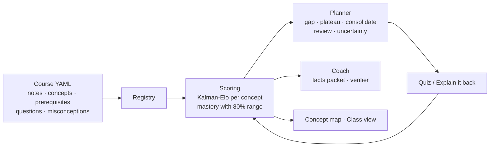

# Lodestar: a study coach that finds why a concept won't stick

Lodestar is an AI study coach for a university course. It finds **which** concepts aren't sticking
and **why**: often the gap is in a concept they build on. It explains them **from the student's own
course notes**, quizzes at the right level, names the **misconception** behind a wrong answer, asks
the student to explain the idea back, and brings concepts back **before they fade**. Teachers see
where the whole class is, as counts.

Every estimate comes with a range, every number the coach says is cited, and every choice comes with
its reason. Lodestar measures what a student knows about the course and nothing else: it never
labels anyone.


## The problem it answers

> How can an AI solution respond to students' difficulties in understanding their courses, enrich
> how they learn, and lastingly improve their educational experience?

| What gets in the way | What Lodestar does |
|---|---|
| A student fails Bayes' theorem again and again, and more Bayes exercises don't help | The **gap rule** walks down the prerequisite map to the deepest shaky concept (here, conditional probability) and starts there, saying why |
| Wrong answers only say "wrong" | Every wrong option is tagged with the **misconception** it shows (swapping P(A\|B) and P(B\|A), the gambler's fallacy…); the feedback names it and gives the fix |
| Being sure and wrong goes unnoticed | **"How sure?"** on every answer: confident errors are flagged as mix-ups, and they're the easiest to fix once seen |
| Re-reading feels like learning | **Explain it back** in your own words; Lodestar shows which key ideas you covered |
| Chatbots make things up | Explanations come **from the course notes**, cited; a verifier rejects any number not in a fact |
| Cramming the night before | **Spaced review**: concepts come back after 1 to 10 days depending on how well they're known |
| Quitting quietly | An **engagement model** trained on 25,273 real students notices drift and offers short, easy sessions |
| Teachers find out at the exam | A **class view**: which concepts the class finds hard and the mix-ups behind them, as counts, no names |

## Try it

You need Docker (with Compose), `make`, and [uv](https://docs.astral.sh/uv/). Node 24 only for
frontend development.

```bash
make up      # creates .env with a fresh encryption key, builds and starts everything
make seed    # Alex, five weeks into Probability 1, and 24 classmates; or press "Demo person"
```

Open the link it prints (http://localhost:5173/?signin=…). Then try:

- **Start studying**: Lodestar goes to conditional probability first, because Bayes' theorem builds
  on it, and switches to explain it back because quizzes alone haven't moved it in 11 days.
- **"I don't get Bayes' theorem"**: the notes on it, where you stand, your usual mix-up, and what
  it builds on.
- **"What do I keep getting wrong?"**: the misconceptions behind your wrong answers, with fixes.
- **Concept map** and **Class view** in the sidebar.

No AI key is needed: Lodestar uses a local [Ollama](https://ollama.com) model if one is running
(`make up-ollama`) and fixed templates otherwise. A hosted model can be added in **Settings → AI
provider** with your own key (stored encrypted, shown as its last 4 characters). The terminal client
works too: `bin/lodestar login --code <token>`, then `bin/lodestar chat`.

## How it decides



1. **Mastery** per concept: the chance of getting a typical question right, with its 80% range
   (Kalman-Elo; the range narrows with answers and widens with time away).
2. **Gap**: a concept under 45% (and fairly surely so) sends Lodestar down its prerequisites to the
   deepest shaky one.
3. **Plateau**: no trend over 10 days and 40 answers changes the format to explain it back, with a
   different way to study.
4. **Consolidate** after a strong quiz; **review** when a concept is due.
5. Otherwise the concept Lodestar knows least about, weighed with goals (exam dates), fatigue and
   repetition. Every part is shown in "Why?".

Design: [docs/plan/19-study-coach.md](docs/plan/19-study-coach.md). Everything else (agent, memory,
coach, ethics) is in [docs/plan](docs/plan/README.md) and [docs/TECHNICAL.md](docs/TECHNICAL.md).

## The course

The demo course is **Probability 1** ([registry/courses/probability.yaml](registry/courses/probability.yaml)):
12 concepts in three chapters, 12 sections of notes, 67 questions, 104 wrong options tagged with 36
misconceptions, each with a fix. A course is data, not code: the loader turns each concept into a
tracked skill with a quiz and an explain-it-back, and validates that every question has exactly one
right answer, every tag exists and the prerequisites have no cycles.

## Evaluation

**Simulated students** with known true levels per concept, playing 5-question quizzes, four a
session, through the real scorer (`make sim N=200`):

| Check | Result | Target |
|---|---|---|
| Recovery of the true level after 10 sessions (correlation, mean over 12 concepts) | 0.84 (0.67 after 3) | > 0.80 |
| 80% ranges containing the true level | 83.0% | 75–85% |
| Success rate in Balanced mode | 80.0% | 80 ± 5% |
| Uncertainty after placement, worst core concept | σ 0.86 | < 0.9 |
| Clicking through quizzes and impossible answers caught (precision / recall) | 1.00 / 1.00 | > 0.9 / > 0.8 |

**Does the gap rule find the gap?** (`python -m simulator.gap_eval --users 200`) Each simulated
student gets one weak concept; everything built on it is held near it, and what it builds on is
solid. After 10 sessions:

| | Found the planted gap |
|---|---|
| Lodestar's gap rule | **72%** (145/200) |
| "Practise your weakest concept" | 24% (48/200) |
| Gap named for students with nothing planted | 5% (10/200) |

**Real data:** the engagement model was trained on one set of real students and tested on others it
never saw (OULAD, 25,273 students: AUC 0.857). The growth-forecast model was trained on 36,297
real learners' practice curves (ranges held 79.7% on held-out players); on course mastery its
coverage hasn't been measured yet.

**Not done yet:** a pilot with a real class, courses drafted from uploaded PDFs, and interfaces in
French and Arabic.

## Development

```bash
make test        # backend (pytest) and frontend (vitest) unit tests
make lint        # ruff, mypy --strict, eslint, prettier, banned-word check
make sim N=200   # the simulated-student checks above
cd frontend && npx playwright test   # end-to-end, against the running stack
```

Rules every contributor follows are in [AGENTS.md](AGENTS.md). Third-party code and licences:
[THIRD_PARTY.md](THIRD_PARTY.md). Course notes follow the order of OpenStax Introductory Statistics
2e (CC BY 4.0); notes and questions are the team's own.

## Licence

[MIT](LICENSE)
